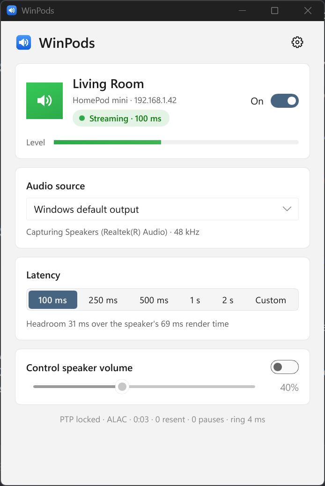
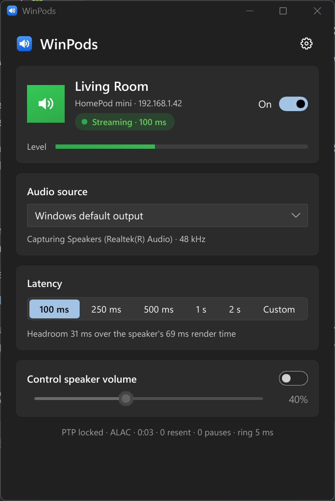

# WinPods

[](https://github.com/sheepy928/WinPods/actions/workflows/build.yml)
[](https://github.com/sheepy928/WinPods/releases/latest)

Stream whatever Windows is playing to a HomePod (or another AirPlay 2 speaker) with an
**ultra low latency mode of 100 ms**, adjustable down to 75 ms. A small native app for
Windows 10/11, written in Rust with a [Slint](https://slint.dev) UI, living in the tray.

<p>
  
  
</p>

* One self-contained `WinPods.exe` (no Python, no runtime to install).
* Follows the Windows light/dark theme; closes to the tray and keeps streaming.
* Reconnects by itself when the speaker or Wi-Fi drops out.
* Follows your default playback device when you switch it.
* Optional: start with Windows, automatic signed updates.

Tested with a HomePod mini on tvOS 27. WinPods speaks AirPlay 2 only (AirPlay 1
devices such as the AirPort Express are not supported).

## Install

1. Download `WinPods-vX.Y.Z-windows-x64.zip` from the
   [latest release](https://github.com/sheepy928/WinPods/releases/latest).
2. Extract it to a folder you keep, for example `%LOCALAPPDATA%\Programs\WinPods`
   (running it from inside the zip works, but then start-with-Windows and updates are off).
3. Run `WinPods.exe`. The exe is not code-signed yet, so SmartScreen may warn the first
   time: *More info* → *Run anyway*.

**Coming from v0.1 (the Python version)?** Quit it from its tray icon first: both
versions use the same ports and speaker session, so only one can run. Your settings
(`%APPDATA%\WinPods\config.json`) carry over.

## First run

1. Enter the HomePod's IP address, or open **Settings → Find…** to pick it from a scan.
2. Turn the speaker card's switch **On**. When Windows asks whether to allow WinPods on
   your network, choose **Allow** (see [Windows Firewall](#windows-firewall)).
3. Play something. Closing the window keeps WinPods running in the tray; quit from the
   tray menu.

## Latency

| Preset | Latency | Good for |
|---|---|---|
| **100 ms** | ultra low | wired PC + decent Wi-Fi, games and video |
| 250 ms | low | busier Wi-Fi |
| 500 ms | normal | congested networks |
| 1 s / 2 s | safe | very unreliable Wi-Fi (2 s is what Apple Music uses) |
| Custom | 75–5000 ms | experimenting |

A HomePod needs about 70 ms between receiving audio and playing it (it reports
`arrivalToRenderLatencyMs: 69`), so 100 ms leaves ~30 ms for Windows capture and Wi-Fi.
The window shows that headroom. Lost packets are re-sent on request, and at 100 ms
there is still time for that. Below ~90 ms expect occasional dropouts.

## Audio source

* **Windows default output** (recommended): captures whatever plays on the current
  default playback device and follows it when you switch devices.
* Any other playback device, e.g. `CABLE Input (VB-Audio Virtual Cable)` if you want
  audio to go only to the HomePod: make the cable the Windows default device and keep
  "Windows default output".
* Recording devices (microphones, line-in) also work.

## Windows Firewall

The HomePod sends its clock (PTP) messages to WinPods on **UDP ports 319 and 320**, so
Windows must allow incoming traffic for WinPods. On first start Windows normally asks;
tick **Private networks** and click *Allow access*. If your connection is set to
*Public* (Settings → Network & internet → Ethernet/Wi-Fi → Network profile type), either
switch it to *Private* for your home network or also allow Public.

If WinPods says *"No clock (PTP) messages from the receiver reached this PC"*, the
firewall is the usual cause. You can add the rule yourself in an **administrator**
PowerShell, pointing `-Program` at where you put `WinPods.exe`:

```powershell
New-NetFirewallRule -DisplayName "WinPods" -Direction Inbound -Action Allow -Protocol UDP `
  -Program "$env:LOCALAPPDATA\Programs\WinPods\WinPods.exe" -Profile Private
```

The rule keeps working after updates because the path does not change. WinPods itself
never changes firewall or other security settings.

## Settings

* **Start with Windows**: adds WinPods to your sign-in apps (minimized to the tray). If
  you disable it in Task Manager → Startup apps, WinPods shows that instead of fighting it.
* **Automatic updates**: once a day WinPods checks GitHub for a newer release. Updates
  are only installed if the release's checksum file carries a valid signature from the
  WinPods release key built into the app; then the new exe is swapped in and WinPods
  restarts (streaming resumes by itself). Without a valid signature you only get a link
  to the release page.
* **Advanced**: clock protocol (PTP for HomePods; NTP for older AirPlay 2 speakers),
  audio format (ALAC; PCM for speakers that need it), renderer (use *software* if the
  window stays blank, e.g. over Remote Desktop), log level, log folder.

Settings live in `%APPDATA%\WinPods\config.json`, the log in
`%APPDATA%\WinPods\winpods.log`.

## Command line

`winpods-cli.exe` (in the same zip) is a diagnostics tool:

```text
winpods-cli --scan                     find AirPlay speakers on the network
winpods-cli --list-devices             list capture devices
winpods-cli --pair-test --ip 192.168.1.155
                                       pair, run SETUP, print what was negotiated
winpods-cli --ip 192.168.1.155 --latency 100 --duration 60
                                       stream until Ctrl+C or for N seconds
    --device "CABLE Input (VB-Audio Virtual Cable) [Loopback]"
    --volume 40                        set the speaker volume on connect
    --test-tone                        stream a quiet beep once a second instead of Windows audio
    --timing PTP|NTP   --codec alac|pcm   --log-level DEBUG
```

Command-line options apply to that run only; they are never saved.

## Building from source

Requirements: Windows 10/11 x64, [Visual Studio Build Tools](https://visualstudio.microsoft.com/visual-cpp-build-tools/)
with the "Desktop development with C++" workload, and [rustup](https://rustup.rs) (the
exact toolchain is pinned in `rust-toolchain.toml` and installed automatically).

```bat
git clone https://github.com/sheepy928/WinPods.git
cd WinPods
cargo build --release
target\release\WinPods.exe
```

`cargo test --workspace` runs the unit and integration tests; none of them touch a real
speaker. `target\release\WinPods.exe --demo` shows the UI with a simulated speaker.

## Releasing

Releases are built and published by GitHub Actions. Bump `version` in the workspace
`Cargo.toml`, commit, and push a tag:

```bat
git tag v0.2.1
git push origin v0.2.1
```

CI checks that the tag matches the version, builds both exes, writes
`SHA256SUMS.txt`, signs it with the release key (GitHub environment `release`, secrets
`MINISIGN_SECRET_KEY` and `MINISIGN_PASSWORD`) and publishes the release with the zip,
the raw exes, the checksums and the signature.

## How it works

```text
WASAPI loopback ─► resample to 44.1 kHz ─► ring ─► sender thread ─► UDP/RTP ─► HomePod
  (audio crate)       (rubato, any rate)    (rt)    ALAC + ChaCha20         ▲
                                                    anchors ◄── PTP clock of the HomePod
```

| Crate | What it does |
|---|---|
| `crates/rt` | monotonic clock, events, high-resolution timers, MMCSS, the capture→sender ring |
| `crates/airplay` | HAP transient pairing (SRP-6a), encrypted RTSP, SETUP, event channel, PTP follower, timing anchors, the real-time RTP sender, unicast mDNS |
| `crates/audio` | WASAPI capture of any playback/recording device, default-device tracking, resampling, test tone |
| `crates/engine` | supervisor: connects everything, reconnects with backoff, publishes status |
| `crates/app` | config, logging, start with Windows, single instance, signed updater |
| `apps/winpods` | the Slint window and tray (`WinPods.exe`) |
| `apps/winpods-cli` | diagnostics CLI |

* **Latency is set by timing anchors.** Once a second WinPods tells the HomePod "the
  frame sent right now must be played *latency* from now", written in the HomePod's own
  PTP timescale (WinPods follows its clock; it never acts as a clock source).
* **Audio** goes as uncompressed ALAC (no encoder delay), one 352-frame packet the moment
  Windows has produced it. Sender and capture threads run with MMCSS "Pro Audio"
  priority and wake on events, not timers.
* **Bursty loopback audio** (Windows delivers it in 10–25 ms bursts) is smoothed by a
  model of the send timeline, so bursts never make the speaker resynchronise; silence is
  only inserted when Windows stops playing, and audio that piles up after a hiccup is
  trimmed so the delay never grows.

The protocol code was ported from the Python v0.1 implementation and
[pyatv](https://github.com/postlund/pyatv); `tools/gen_fixtures.py` generates test
vectors from that code so the Rust port is checked byte for byte. The Python version is
kept in `legacy/python/` for reference.

## License and credits

WinPods is [MIT licensed](LICENSE). The UI is made with [Slint](https://slint.dev), used
under the Slint Royalty-free Desktop License (see *About* in the app). Third-party
licenses are listed in `THIRD-PARTY-NOTICES.html` in each release. Protocol knowledge
comes from [pyatv](https://github.com/postlund/pyatv),
[shairport-sync](https://github.com/mikebrady/shairport-sync) and
[owntone](https://github.com/owntone/owntone-server).
